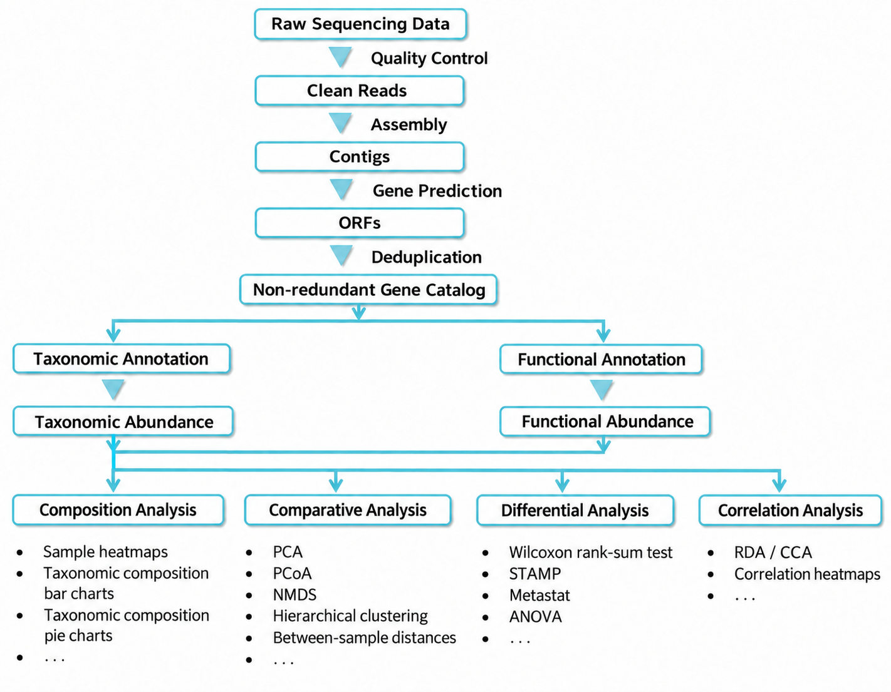
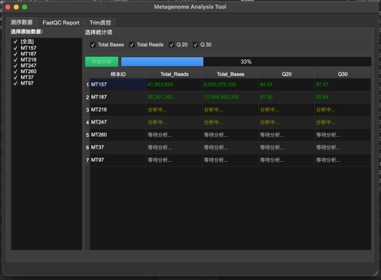
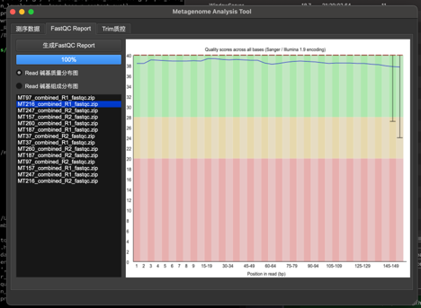
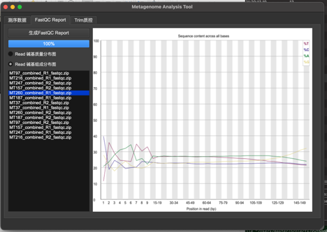

> **Public demo — partial source code.** This public repository contains selected source files from the METAGENOME project for demonstration, **not** contain the complete application or the full analysis pipeline.

# METAGENOME

METAGENOME is a laboratory software project for metagenomic sequencing data processing and analysis. It combines a Python/PySide6 desktop interface, native C/C++ FASTQ statistics, and established bioinformatics tools to organize quality control, read trimming, assembly, and result inspection.

The public source demonstrates selected components and their integration. Additional code, environment configuration, and tool setup may be required to reproduce a complete workflow.

## Demo Scope

| Area | Components represented in this repository |
| --- | --- |
| Raw FASTQ statistics | Sample selection, read and base counts, Q20/Q30 statistics, background processing, and CSV result persistence. |
| FastQC reports | External FastQC execution, progress reporting, and display of per-base sequence quality and base-composition plots from report archives. |
| Read trimming | An interactive CLI wrapper for Trimmomatic, with paired-end/single-end options, adapter selection, configurable trimming parameters, and command confirmation. |
| Assembly and statistics | CLI integration with MEGAHIT and SeqKit for assembly and contig statistics, including N50 and N90. |
| Contig visualization | Biopython, NumPy, and Matplotlib utilities for generating contig-length distributions. |

The desktop trimming integration is unfinished in this public snapshot; the trimming workflow is represented by the CLI scripts. Interfaces and screenshots retain their original language where applicable.

## Workflow



This diagram describes the broader metagenomic analysis workflow. **It is a workflow overview, not a list of features fully implemented in this public demo.** Gene prediction, non-redundant gene catalog construction, taxonomic and functional annotation, and downstream composition, comparative, differential, and correlation analyses are shown for context.

The source published here focuses on the components listed in [Demo Scope](#demo-scope), particularly FASTQ statistics, FastQC reporting, read trimming, assembly, and contig inspection.

## Architecture

The application uses a layered, event-driven desktop architecture alongside separate command-line workflows:

- **Presentation:** PySide6 widgets and Qt Designer UI definitions provide sample selection, progress indicators, result tables, and report visualization.
- **Analysis coordination:** Python processors organize input discovery, task submission, report loading, and result updates.
- **Background execution:** Qt threads, a bounded thread pool, and signals/slots separate long-running work from UI updates.
- **Tool integration:** Subprocess wrappers invoke native FASTQ executables, FastQC, Trimmomatic, MEGAHIT, and SeqKit.
- **Persistence:** CSV files store sample statistics for later reuse; reports, processed reads, assemblies, and plots are written to local output directories.

Native FASTQ statistics use kseq and zlib to read compressed sequencing files. The C++ implementation includes parallel processing of paired input files. FastQC generates the quality and composition plots; the desktop application reads their SVG content from report archives and renders it with Qt.

### Source Layout

```text
main.py                     Desktop application entry point
gui/                        Windows, Qt Designer files, and generated UI code
core/                       FASTQ analysis, report handling, and CSV persistence
utils/thread_utilies/       Background tasks, signals, and thread-pool management
tools/readfq/               Native C/C++ FASTQ statistics and kseq parser
shell_scripts/              Interactive trimming, assembly, and plotting workflows
constant_values/config.py   Desktop configuration values and tool paths
```

## Environment Preparation

Dependencies depend on the component being explored:

- **Desktop interface:** Python 3 and a compatible PySide6 installation.
- **Native statistics:** A C/C++ compiler and zlib development headers/libraries.
- **Quality reports:** FastQC and its required runtime.
- **Read trimming:** Java and Trimmomatic. A Trimmomatic 0.39 distribution and adapter files are included under `shell_scripts/Trimmomatic-0.39/`.
- **Assembly and contig statistics:** MEGAHIT and SeqKit.
- **Contig plots:** Biopython, NumPy, and Matplotlib.

The public snapshot does not include a complete, pinned environment specification. Prepare the required tools for your platform and check the executable paths expected by the wrappers before running a component. The command-line examples below follow the Linux workflow; cross-platform support has not been established for every published component.

## Usage

These entry points illustrate the published source. They are not a complete installation guide for the full application.

### Prepare Input Files

Keep compressed FASTQ files in a sample directory, with consistent paired-read names:

```text
samples/
  SAMPLE001_combined_R1.fastq.gz
  SAMPLE001_combined_R2.fastq.gz
  SAMPLE002_combined_R1.fastq.gz
  SAMPLE002_combined_R2.fastq.gz
```

The desktop sample grouping uses the filename prefix before the first underscore as the sample ID. Use distinct sample IDs for distinct samples. Saved statistics are reused by sample ID; replacing input files does not automatically invalidate previously stored results.

### Desktop Entry Point

From the repository root:

```bash
python main.py
```

The intended desktop workflow is to configure the FASTQ directory, native statistics executable, and FastQC report directory, then select samples and statistics or generate and inspect FastQC reports. Relevant configuration is defined in `constant_values/config.py` and the setup window.

Some GUI integrations are incomplete in this public snapshot, so running the full desktop workflow may require additional implementation and configuration.

#### FASTQ Data Analysis

Select samples and the statistics to display, then start the analysis. The table shows read counts, base counts, Q20/Q30 results, and the status of each sample while background tasks run.



#### FastQC Reports

Generate FastQC reports, select a report from the list, and switch between per-base sequence quality and base-composition views.

**Per-base sequence quality**



**Per-base sequence composition**



These demo screenshots retain the original UI labels.

### Command-Line Workflows

Run the CLI from its own directory so its local imports and bundled-tool paths resolve as expected:

```bash
cd shell_scripts
python metagenome_main.py
```

Enter the absolute path to your sample directory. The interactive menu provides:

1. **Read trimming:** Choose the sequencing mode and input reads, select adapters, set trimming parameters and thread count, review the generated command, and confirm execution.
2. **Assembly:** Select the trimmed-read directory, set the thread count and minimum contig length, review the MEGAHIT command, and optionally calculate assembly statistics.
3. **Contig-length visualization:** Set the histogram bin count and maximum displayed length, then generate a combined distribution from assembly results under the sample directory.
4. **Exit.**

### Outputs

Depending on the selected component and configured paths, outputs include:

- Sample statistics in `fastQ_analysis/stats.csv` beneath the FASTQ input directory.
- FastQC report archives in the configured report directory.
- Trimmed reads, including paired and unpaired outputs for paired-end processing.
- MEGAHIT assembly directories containing `final.contigs.fa`.
- A `contig_length_distribution.png` plot.
- Execution and diagnostic logs.

## Development Tools

The repository includes pre-commit configuration for Black, Flake8, isort, mypy, and basic whitespace, YAML, and debug-statement checks. The presence of this configuration does not establish that all checks pass for this partial snapshot.

## References

- [readfq / kseq](https://github.com/lh3/readfq)
- [FastQC](https://github.com/s-andrews/FastQC)
- [Trimmomatic](https://github.com/usadellab/Trimmomatic)
- [MEGAHIT](https://github.com/voutcn/megahit)

## License

Project source is provided under the [MIT License](LICENSE). Third-party tools and bundled resources retain their respective licenses.
